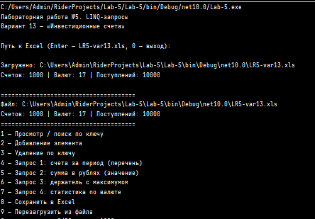
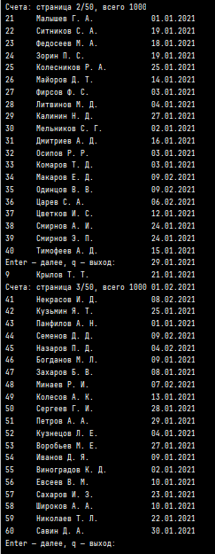
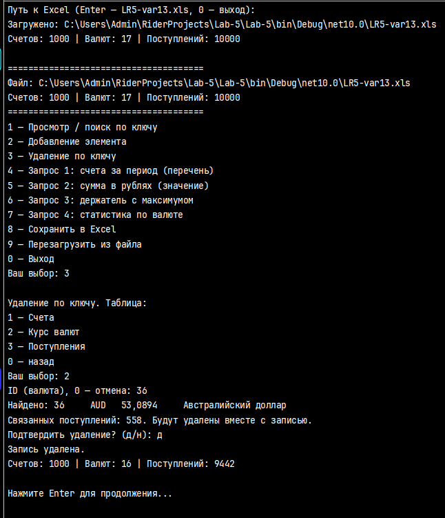
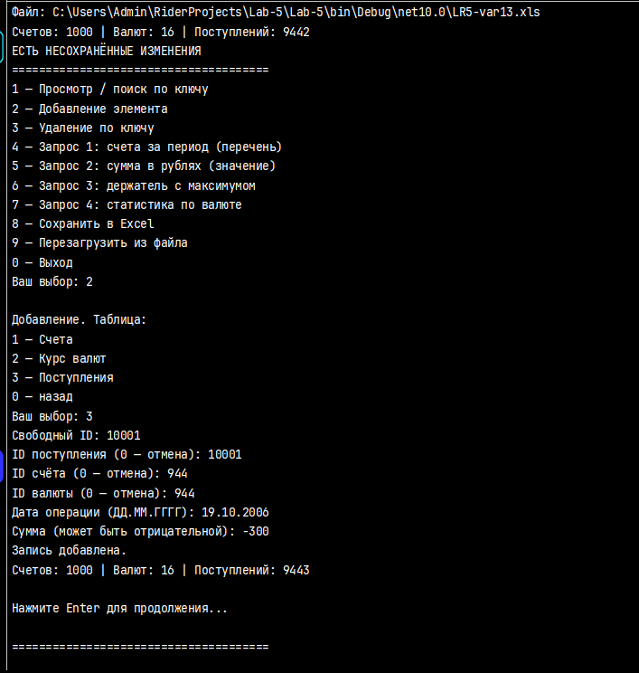
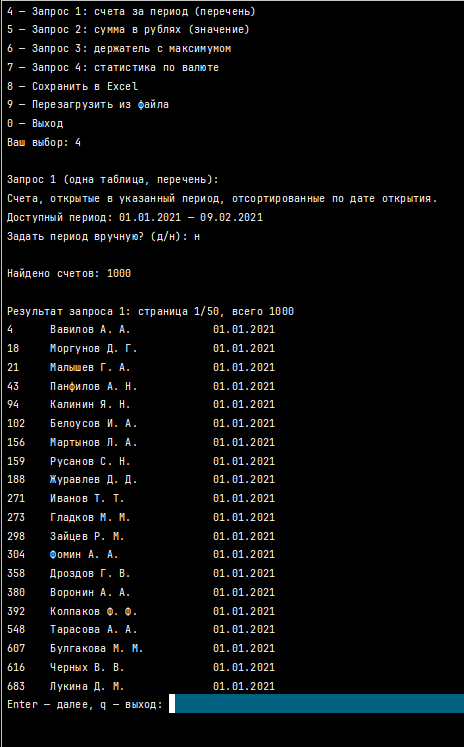
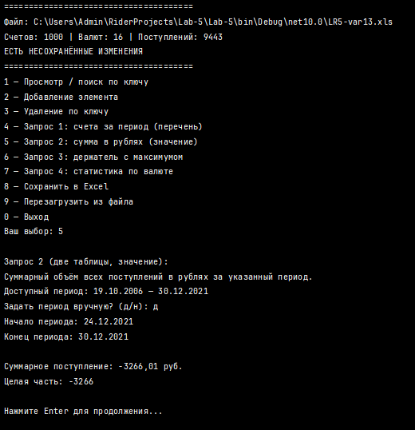
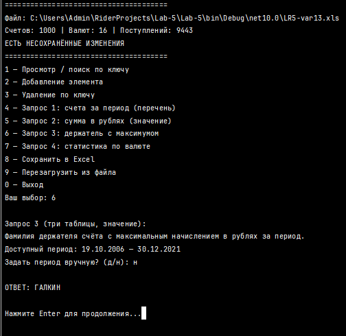
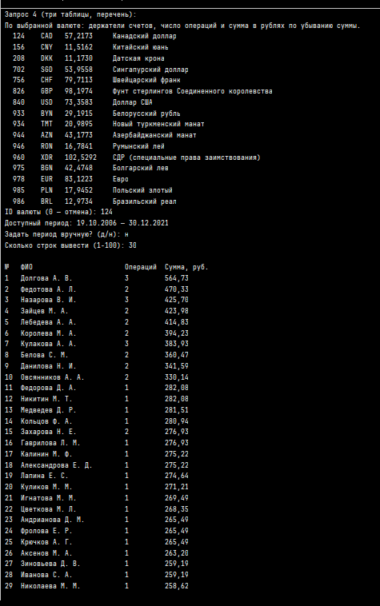
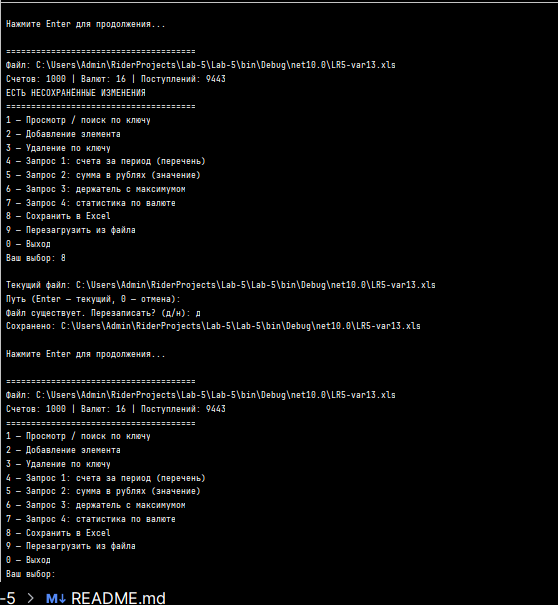

# Лабораторная работа №5 — LINQ-запросы

**Автор:** Чичарин Денис, ИТ-2  
**Вариант:** 13 — «Инвестиционные счета»

---

## Постановка задачи

Разработать консольное приложение с дружественным интерфейсом и возможностью выбора заданий, которое выполняет:

1. Чтение базы данных из Excel-файла.
2. Просмотр базы данных.
3. Удаление элементов по ключу.
4. Добавление элементов.
5. Реализацию 4 запросов:
   - 1 запрос с обращением к **одной** таблице;
   - 1 запрос с обращением к **двум** таблицам;
   - 2 запроса с обращением к **трём** таблицам;
   - 2 запроса возвращают **перечень**, 2 запроса — **одно значение**.
6. Сохранение изменений в Excel-файле.

Элементами базы данных являются объекты классов согласно варианту. Классы содержат свойства, конструкторы и перегруженный метод `ToString()`. Весь функционал приложения реализован в виде методов вспомогательного класса с помощью LINQ-запросов. Предусмотрена обработка возможных ошибок.

В отличие от лабораторной работы №4, в данной работе **разрешено использование LINQ-запросов**, что и применено во всех выборках.

---

## Структура базы данных

Файл `LR5-var13.xls` содержит три таблицы.

| Таблица | Поля | Записей |
|---|---|---|
| **Счета** | `ID`, `ФИО`, `Дата открытия вклада` | 1000 |
| **Курс валют** | `ID`, `Буквенный код`, `Курс`, `Полное наименование` | 17 |
| **Поступления** (в ТЗ — «Начисления») | `ID`, `ID счёта`, `ID валюты`, `Дата`, `Сумма` | 10000 |

Связи: `Поступления.ID счёта → Счета.ID`, `Поступления.ID валюты → Курс валют.ID`.

Особенности данных:
- курс валют постоянен на весь период (одна запись на валюту);
- сумма начисления может быть **отрицательной**;
- даты операций — с 24.12.2021 по 30.12.2021;
- пересчёт в рубли: `Сумма × Курс`.

---

## Структура проекта

| Файл | Назначение |
|---|---|
| `Models.cs` | классы предметной области: `Account`, `CurrencyRate`, `Transaction`, контейнер `Database` |
| `ExcelService.cs` | чтение и запись Excel через NPOI |
| `DatabaseHelper.cs` | **вспомогательный класс** — весь функционал приложения на LINQ |
| `ConsoleHelper.cs` | валидация пользовательского ввода |
| `Program.cs` | точка входа, главное меню, обработка исключений |

---

## Используемые библиотеки

| Библиотека | Назначение |
|---|---|
| **NPOI** | чтение и запись `.xls` / `.xlsx` |
| `System.Linq` | LINQ-запросы |
| `System.Collections.Generic` | `List<T>`, `HashSet<T>`, `Dictionary<K,V>` |
| `System.IO` | файловые потоки |
| `System.Globalization` | парсинг дат и чисел |

**Почему NPOI.** Исходный файл выдан в формате `.xls` (Excel 97-2003). ClosedXML и EPPlus этот формат не читают, ExcelDataReader не умеет записывать, Interop требует установленный Excel. NPOI поддерживает оба формата, чтение и запись, работает кроссплатформенно.

### Настройка проекта

```powershell
dotnet add package NPOI
```

`Lab-5.csproj`:

```xml
<PropertyGroup>
  <OutputType>Exe</OutputType>
  <TargetFramework>net10.0</TargetFramework>
  <Nullable>disable</Nullable>
  <AcceptNPOIOSMFLicense>true</AcceptNPOIOSMFLicense>
</PropertyGroup>

<ItemGroup>
  <PackageReference Include="NPOI" Version="2.7.1" />
</ItemGroup>

<ItemGroup>
  <None Update="LR5-var13.xls">
    <CopyToOutputDirectory>PreserveNewest</CopyToOutputDirectory>
  </None>
</ItemGroup>
```

---

## Классы предметной области

### Account — таблица «Счета»

| Член | Тип | Назначение |
|---|---|---|
| `Id` | `int` | код счёта (ключ) |
| `FullName` | `string` | ФИО владельца |
| `OpenDate` | `DateTime` | дата открытия вклада |

Конструкторы: без параметров и с параметрами `(int id, string fullName, DateTime openDate)`.
`ToString()` возвращает `ID`, ФИО и дату в формате `dd.MM.yyyy` с выравниванием по колонкам.

### CurrencyRate — таблица «Курс валют»

| Член | Тип | Назначение |
|---|---|---|
| `Id` | `int` | числовой код валюты (ключ) |
| `Code` | `string` | буквенный код (USD, EUR, …) |
| `Rate` | `double` | курс к рублю |
| `Name` | `string` | полное наименование |

Конструкторы: без параметров и `(int id, string code, double rate, string name)`.
`ToString()` выводит код, курс с 4 знаками и наименование.

### Transaction — таблица «Поступления»

| Член | Тип | Назначение |
|---|---|---|
| `Id` | `int` | код операции (ключ) |
| `AccountId` | `int` | внешний ключ на «Счета» |
| `CurrencyId` | `int` | внешний ключ на «Курс валют» |
| `Date` | `DateTime` | дата операции |
| `Amount` | `double` | сумма (может быть отрицательной) |

Конструкторы: без параметров и `(int id, int accountId, int currencyId, DateTime date, double amount)`.
`ToString()` выводит все поля, сумма — с 2 знаками.

### Database — контейнер

Содержит `List<Account> Accounts`, `List<CurrencyRate> Rates`, `List<Transaction> Transactions`, а также `SourcePath` (путь к файлу) и `HasChanges` (признак несохранённых изменений).

---

## Пункт 1. Чтение базы данных из Excel

### Алгоритм решения

1. Метод `ExcelService.Load(path)` проверяет существование файла; при отсутствии выбрасывается `FileNotFoundException`.
2. `WorkbookFactory.Create(path)` открывает книгу, автоматически определяя формат (`.xls` → `HSSFWorkbook`, `.xlsx` → `XSSFWorkbook`).
3. Метод `FindSheet` ищет лист по имени без учёта регистра и пробелов; предусмотрены синонимы («Поступления» / «Начисления», «Курс валют» / «Валюты»). Если имя не найдено — используется лист по индексу.
4. Каждая таблица читается обобщённым методом `ReadTable<T>(ISheet, Func<int, IRow, T>)`:
   - строки без положительного целого `ID` пропускаются (заголовки, пустые строки);
   - `HashSet<int>` отбрасывает повторяющиеся ключи;
   - функция-преобразователь возвращает `null` для некорректной строки — такая строка не попадает в коллекцию.
5. Разбор ячеек выполняется методами `TryInt`, `TryDouble`, `TryDate`, которые учитывают тип ячейки (`Numeric`, `String`, `Formula` через `CachedFormulaResultType`):
   - **целое** читается строго: дробное значение в колонке ID считается некорректным;
   - **вещественное** принимает и точку, и запятую как разделитель, проверяется `double.IsFinite`;
   - **дата** обрабатывается в двух вариантах: числовой серийный номер Excel преобразуется `DateUtil.GetJavaDate`, текстовая строка — `DateTime.TryParseExact` по шаблону `dd.MM.yyyy`.
6. Если таблицы «Счета» или «Курс валют» пусты — выбрасывается `InvalidDataException`.
7. Дополнительно выявляются «сироты» — операции, ссылающиеся на несуществующие счета или валюты; о них выводится предупреждение.

### Тестирование

<p align="center">

</p>

---

## Пункт 2. Просмотр базы данных

### Алгоритм решения

1. Пользователь выбирает таблицу (1 — Счета, 2 — Курс валют, 3 — Поступления, 0 — назад).
2. Выбирается режим: постраничный просмотр или поиск по ключу.
3. **Постраничный просмотр** реализован обобщённым методом `ShowPages<T>`:
   - записи сортируются по ключу: `db.Accounts.OrderBy(a => a.Id)`;
   - размер страницы — 20 записей, что позволяет работать с 10000 операций без «вываливания» всего списка в консоль;
   - порция выбирается LINQ-методами `.Skip(page * PageSize).Take(PageSize)`;
   - навигация: `Enter` — следующая страница, `q` — выход.
4. **Поиск по ключу** выполняется методом `FirstOrDefault(x => x.Id == id)`; при отсутствии записи выводится соответствующее сообщение.

### Тестирование

<p align="center">

</p>

---

## Пункт 3. Удаление элементов по ключу

### Алгоритм решения

Удаление реализовано **обобщённым методом** `DeleteByKey<T>`, который принимает список, селектор ключа, название таблицы и две функции для работы со связанными записями. Это позволило заменить три почти одинаковых метода одним.

Порядок работы:

1. Ввод ключа методом `ReadIdOrCancel`; **0 отменяет операцию на любом шаге**.
2. Поиск записи: `table.FirstOrDefault(x => key(x) == id)`. Если запись не найдена — сообщение и выход.
3. Найденная запись выводится на экран для подтверждения.
4. Подсчитывается количество связанных операций: `db.Transactions.Count(t => t.AccountId == id)`.
5. Если связи есть, выводится предупреждение, что они будут удалены каскадно, и запрашивается подтверждение.
6. После подтверждения выполняется `removeRelated(id)` (каскад) и `table.Remove(item)`.
7. **Самопроверка**: повторный поиск `table.Any(x => key(x) == id)` подтверждает, что запись действительно удалена.
8. Устанавливается флаг `HasChanges`, выводятся новые счётчики записей.

Каскадное удаление сохраняет ссылочную целостность: при удалении счёта или валюты связанные с ними операции также удаляются, «сирот» не остаётся.

### Тестирование

<p align="center">

</p>

---

## Пункт 4. Добавление элементов

### Алгоритм решения

1. Выбирается таблица-приёмник.
2. **Ключ** вводится методом `NewKey`: множество занятых ключей загружается в `HashSet<int>`, пользователю показывается свободный ID (`used.Max() + 1`), проверка занятости выполняется за O(1). Повторный ключ отвергается.
3. **Внешние ключи** (`ID счёта`, `ID валюты`) вводятся методом `ForeignKey` — принимается только существующий ключ, что исключает появление «сирот».
4. Валидация остальных полей:
   - ФИО — непустая строка ограниченной длины;
   - буквенный код валюты — ровно 3 латинские буквы `A–Z`, без повторов (регистронезависимо);
   - курс — конечное положительное число;
   - дата — `DateTime.TryParseExact` по шаблону `dd.MM.yyyy` с проверкой диапазона года;
   - сумма — конечное ненулевое число, знак допускается любой.
5. Создаётся объект соответствующего класса и добавляется в коллекцию.
6. Устанавливается `HasChanges`, выводятся новые счётчики.
7. Ввод `0` на любом шаге отменяет добавление.

### Тестирование

<p align="center">

</p>

---

## Пункт 5. LINQ-запросы

### Сводная таблица соответствия требованиям

| № | Таблицы | Кол-во | Терминальный оператор | Результат |
|---|---|---|---|---|
| **1** | Счета | **1** | `.ToList()` | **перечень** |
| **2** | Поступления + Курс валют | **2** | `.Sum()` | **значение** |
| **3** | Поступления + Курс валют + Счета | **3** | `.FirstOrDefault()` | **значение** |
| **4** | Поступления + Курс валют + Счета | **3** | `.Take(n).ToList()` | **перечень** |

Требования выполнены: одна таблица — 1 запрос, две — 1 запрос, три — 2 запроса; перечней — 2, значений — 2.

Период для всех запросов задаётся пользователем: по умолчанию берётся фактический диапазон данных (`Min` / `Max` по дате), при желании вводится вручную с проверкой «начало не позже конца».

---

### Запрос 1 — одна таблица, перечень

**Формулировка.** Получить перечень счетов, открытых в указанный период, отсортированный по дате открытия и коду счёта.

**Задействованные таблицы:** «Счета».

```csharp
List<Account> result = (
    from account in db.Accounts
    where account.OpenDate >= start &&
          account.OpenDate <= end
    orderby account.OpenDate, account.Id
    select account).ToList();
```

Один оператор `from`, ни одного `join` — обращение к одной таблице. Результат — `List<Account>`, то есть перечень.

<p align="center">

</p>

---

### Запрос 2 — две таблицы, одно значение

**Формулировка.** Определить суммарный объём всех поступлений в рублях за указанный период, считая, что обмен валюты производился в момент поступления.

**Задействованные таблицы:** «Поступления», «Курс валют».

```csharp
double total = (
    from transaction in db.Transactions
    join rate in db.Rates
        on transaction.CurrencyId equals rate.Id
    where transaction.Date >= start &&
          transaction.Date <= end
    select transaction.Amount * rate.Rate).Sum();
```

Один `from` + один `join` — две таблицы. Соединение необходимо: сумма хранится в валюте, курс — в справочнике. Агрегат `.Sum()` входит в состав запроса, поэтому запрос возвращает **одно значение** типа `double`.

<p align="center">

</p>

---

### Запрос 3 — три таблицы, одно значение

**Формулировка.** Определить держателя счёта с максимальным начислением в рублях за указанный период. В ответе вывести его фамилию заглавными буквами.

*(Запрос из примера к варианту 13. Эталонный ответ — `ГАЛКИН`.)*

**Задействованные таблицы:** «Поступления», «Курс валют», «Счета».

```csharp
string surname = (
    from transaction in db.Transactions
    join rate in db.Rates
        on transaction.CurrencyId equals rate.Id
    join account in db.Accounts
        on transaction.AccountId equals account.Id
    where transaction.Date >= start &&
          transaction.Date <= end
    group transaction.Amount * rate.Rate
        by account.FullName into holder
    orderby holder.Sum() descending, holder.Key
    select holder.Key.Split(
        new[] { ' ' },
        StringSplitOptions.RemoveEmptyEntries)[0])
    .FirstOrDefault();
```

Один `from` + два `join` — три таблицы. Все три необходимы: сумма берётся из «Поступлений», курс — из «Курса валют», ФИО — из «Счетов».

Группировка `group ... by account.FullName` собирает начисления по владельцу, `holder.Sum()` даёт рублёвый итог, сортировка по убыванию ставит лидера первым. Вторичная сортировка по ключу обеспечивает детерминированность при равных суммах. `.FirstOrDefault()` возвращает **одно значение** — фамилию.

**Контроль корректности:** на полном периоде запрос выводит `ГАЛКИН`, что совпадает с эталонным ответом из методички.

<p align="center">

</p>

---

### Запрос 4 — три таблицы, перечень

**Формулировка.** Для выбранной валюты получить перечень держателей счетов, совершавших операции в этой валюте за указанный период, с указанием числа операций и суммарной суммы в рублях; результат отсортировать по убыванию суммы и вывести первые N записей.

**Задействованные таблицы:** «Поступления», «Курс валют», «Счета».

```csharp
var joined =
    from transaction in db.Transactions
    join rate in db.Rates
        on transaction.CurrencyId equals rate.Id
    join account in db.Accounts
        on transaction.AccountId equals account.Id
    where transaction.CurrencyId == currencyId &&
          transaction.Date >= start &&
          transaction.Date <= end
    select new
    {
        account.FullName,
        Rubles = transaction.Amount * rate.Rate
    };

var result = (
    from item in joined
    group item by item.FullName into holder
    orderby holder.Sum(x => x.Rubles) descending
    select new
    {
        Name = holder.Key,
        Count = holder.Count(),
        Total = holder.Sum(x => x.Rubles)
    })
    .Take(top)
    .ToList();
```

Один `from` + два `join` — три таблицы. Дополнительно продемонстрированы групповые агрегаты `Count()` и `Sum()`, сортировка `orderby ... descending` и ограничение выборки `.Take(n)`. Результат — **перечень**.

<p align="center">

</p>

---

## Пункт 6. Сохранение изменений в Excel

### Алгоритм решения

1. Пользователь указывает путь; `Enter` — сохранить в текущий файл, `0` — отмена.
2. Проверяется расширение (`.xls` или `.xlsx`); при перезаписи существующего файла запрашивается подтверждение.
3. Тип книги выбирается по расширению: `HSSFWorkbook` для `.xls`, `XSSFWorkbook` для `.xlsx`.
4. Все три листа записываются **универсальным методом** `WriteSheet(book, name, headers, rows, headerStyle, dateStyle)`:
   - данные передаются как `IEnumerable<object[]>`, формируемая LINQ-проекцией, например:
     ```csharp
     db.Accounts.Select(a =>
         new object[] { a.Id, a.FullName, a.OpenDate })
     ```
   - тип значения определяется сопоставлением с образцом: `DateTime` записывается как настоящая дата Excel с форматом `dd.mm.yyyy`, `int` и `double` — как числа, остальное — как текст;
   - заголовки оформляются полужирным шрифтом, задаётся ширина колонок.
5. Книга сохраняется в `FileStream` внутри `using`, что гарантирует освобождение ресурса.
6. Сбрасывается флаг `HasChanges`, обновляется `SourcePath`.

При выходе из программы, если есть несохранённые изменения, предлагается сохранить их; при ошибке сохранения — выйти без сохранения или остаться в программе.

### Тестирование

<p align="center">

</p>

---

## Обработка ошибок и валидация ввода

| Ситуация | Реакция программы |
|---|---|
| Файл не найден | `FileNotFoundException`, сообщение, повторный запрос пути |
| В файле нет нужных листов | `InvalidDataException` с пояснением |
| Некорректная строка в таблице | строка пропускается, ведётся счётчик пропущенных |
| Дубликат ключа при чтении | отбрасывается через `HashSet<int>` |
| Дробное значение в колонке ID | строка считается некорректной |
| Дата как число / как текст | обрабатываются оба варианта хранения |
| Бесконечность / переполнение числа | `double.IsFinite`, отклонение ввода |
| Ввод нечислового значения | `TryParse`, повторный запрос |
| Ключ уже занят / не существует | проверка `HashSet`, повторный запрос |
| Отрицательный результат вычитания | не допускается (по условию варианта) |
| Начало периода позже конца | повторный ввод |
| Файл занят другим процессом | перехват исключения в меню, сообщение |
| Выход с несохранёнными изменениями | предложение сохранить |

Все операции главного меню обёрнуты в `try/catch`, поэтому любое исключение выводится как понятное сообщение и **не завершает работу программы**. Ввод `0` отменяет операцию на любом шаге.

---

## Соответствие требованиям ТЗ

| Пункт | Реализация | Балл |
|---|---|---|
| 1. Чтение из Excel | `ExcelService.Load`, `ReadTable<T>` | 1 |
| 2. Просмотр БД | `DatabaseHelper.View`, `ShowPages<T>`, поиск по ключу | 1 |
| 3. Удаление по ключу | `DatabaseHelper.Delete`, `DeleteByKey<T>` с каскадом | 1 |
| 4. Добавление | `DatabaseHelper.Add`, `NewKey`, `ForeignKey` | 1 |
| 5.1 Запрос к 1 таблице | Запрос 1 (перечень) | 0,5 |
| 5.2 Запрос к 2 таблицам | Запрос 2 (значение) | 0,5 |
| 5.3 Два запроса к 3 таблицам | Запрос 3 (значение), Запрос 4 (перечень) | 2 |
| 6. Сохранение в Excel | `ExcelService.Save`, `WriteSheet` | 1 |
| Классы: свойства, конструкторы, `ToString` | `Models.cs` | — |
| Функционал в вспомогательном классе на LINQ | `DatabaseHelper.cs` | — |
| Обработка ошибок | `try/catch`, валидация, пропуск битых строк | — |

---
